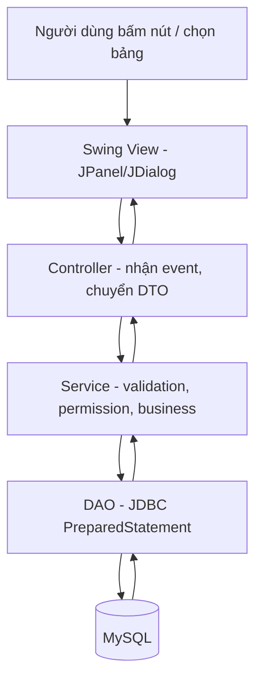

# KIẾN TRÚC JAVA SWING — MVC + SERVICE + DAO

## 1. Kiến trúc đề xuất


Không cần web server/Tomcat. Chương trình bắt đầu ở `Main.main`, tạo `AppContext` rồi mở `MainFrame` trên **Swing EDT**.

## 2. Cấu trúc thư mục cố định
```text
storephone-swing/
├── pom.xml
├── README.md
├── config.example.properties
├── .gitignore
├── sql/                     # SQL schema và seed local
├── assets/                  # hình mẫu mặc định không chứa dữ liệu nhạy cảm
└── src/
    ├── main/
    │   ├── java/com/storephone/
    │   │   ├── Main.java
    │   │   ├── config/{AppContext,DatabaseConfig,ConnectionFactory}.java
    │   │   ├── model/{User,Role,Product,Cart,CartItem,Order,OrderItem}.java
    │   │   ├── dto/{RegisterRequest,LoginRequest,ProductForm,ProductSearchCriteria,CheckoutRequest}.java
    │   │   ├── dao/{UserDAO,RoleDAO,ProductDAO,CartDAO,OrderDAO}.java
    │   │   ├── dao/jdbc/{JdbcUserDAO,JdbcRoleDAO,JdbcProductDAO,JdbcCartDAO,JdbcOrderDAO}.java
    │   │   ├── service/{AuthService,AuthorizationService,UserService,ProductService,CartService,CheckoutService,OrderService,DashboardService}.java
    │   │   ├── controller/{AuthController,UserController,ProductController,CartController,OrderController,DashboardController}.java
    │   │   ├── view/{MainFrame,LoginPanel,RegisterPanel,HomePanel,ProductListPanel,ProductDetailDialog,CartPanel,CheckoutPanel,OrderHistoryPanel,AdminDashboardPanel,AdminUserPanel,AdminProductPanel,AdminOrderPanel}.java
    │   │   ├── view/component/{ProductTableModel,UserTableModel,OrderTableModel}.java
    │   │   ├── security/{AppSession,PasswordHasher}.java
    │   │   ├── util/{InputValidator,MoneyFormatter,ImageStorage,UiTaskRunner}.java
    │   │   └── exception/{ValidationException,AuthorizationException,InsufficientStockException}.java
    │   └── resources/{app.properties,icons/}
    └── test/java/com/storephone/...
```
`{A,B}.java` chỉ là ký hiệu rút gọn trong sơ đồ, **mỗi class phải có file `.java` riêng**.

## 3. Trách nhiệm từng tầng
- **View:** vẽ giao diện, hiển thị DTO, nhận input và báo lỗi. Không chứa SQL, không tự kiểm tra role bằng cách tin vào nút đã ẩn.
- **Controller:** gắn listener; đọc input → tạo request DTO → gọi service → cập nhật panel/hiển thị lỗi; không trực tiếp dùng `Connection`.
- **Service:** kiểm tra hợp lệ và nghiệp vụ; `requireRole`; xử lý thay đổi tồn kho, transaction; chịu trách nhiệm điều kiện an toàn.
- **DAO:** SQL, mapping `ResultSet` thành model/DTO, `PreparedStatement`, `try-with-resources`; không đụng Swing.
- **Model:** data/domain; `BigDecimal` cho tiền, `LocalDateTime`/`Timestamp` cho ngày.
- **AppContext:** constructor injection thủ công, khởi tạo DAO → service → controller; tránh `new DAO` rải rác trong panel.

## 4. Luồng mẫu: lưu sản phẩm
```text
AdminProductPanel.btnSave
 → ProductController.onSave(form)
 → ProductService.createProduct(form)
 → InputValidator.validateProduct()
 → AuthorizationService.requireAdmin()
 → ProductDAO.insert(Product)
 → trả Product id
 → ProductController.reloadPage()
 → ProductTableModel.fireTableDataChanged()
```
Đối với ảnh: `JFileChooser` → `ImageStorage.save()` rồi lưu tên/path trong DB; cần có xử lý dọn file nếu DB lỗi.

## 5. Luồng khởi tạo app
1. `Main.main()` đọc config và kiểm tra thư mục ảnh.
2. Tạo `ConnectionFactory`.
3. Tạo `Jdbc*DAO` và service bằng constructor.
4. Trong `SwingUtilities.invokeLater`, tạo `MainFrame`, `CardLayout`, khai báo route nội bộ bằng tên thẻ `HOME/LOGIN/REGISTER/ADMIN/...`.
5. Mở `HOME` cho GUEST.
6. Tác vụ nặng như query DB chạy bằng `SwingWorker`, `done()` cập nhật UI trên EDT; disable nút gửi khi đang xử lý và enable lại.

## 6. API service tối thiểu (hợp đồng)
```java
interface AuthService {
    UserSession login(String email, char[] password);
    void register(RegisterRequest request);
    void logout();
}
interface ProductService {
    long create(ProductForm form);
    void update(long id, ProductForm form);
    void deactivate(long id);
    Product findById(long id);
    PageResult<Product> search(ProductSearchCriteria criteria);
}
interface CartService {
    CartView getCurrentCart();
    void add(long productId, int qty);
    void setQuantity(long productId, int qty);
    void remove(long productId);
}
interface CheckoutService {
    long placeOrder(CheckoutRequest request);
}
```
Đây là hợp đồng **đề xuất**, không phải class có sẵn trong repo. `PageResult` là DTO gồm items, page, pageSize, totalItems, totalPages.

## 7. Bất biến cần bảo vệ
1. GUEST không được add cart/checkout.
2. USER không gọi thành công service của ADMIN, kể cả khi dùng reflection/đường đi UI khác; service luôn kiểm tra quyền.
3. Mật khẩu chỉ lưu BCrypt; không đưa password hash lên JTable.
4. `price > 0`, `quantity >= 0`, email duy nhất, giỏ không có dòng trùng sản phẩm.
5. Đặt hàng thành công thì **cùng lúc** tạo order/order_items, trừ tồn, làm trống giỏ. Lỗi ở bất kỳ bước nào phải rollback.
6. Đơn hàng cũ có giá mua tại thời điểm tạo (`order_items.unit_price`), không lấy giá sản phẩm hiện tại để tính lịch sử.
7. `carts.total_quantity` phải bằng `SUM(cart_items.quantity)` hoặc bỏ cột để tính động; trong schema kèm theo chọn **có cột và cập nhật lại bằng SUM trong transaction**.

## 8. Xử lý sự kiện và lỗi
```text
click Save → khóa nút → SwingWorker.doInBackground() gọi service
 → done() đọc kết quả/exception
 → thành công: thông báo + reload TableModel
 → thất bại: hiển thị lỗi thân thiện + log stacktrace
 → mở khóa nút
```
- `SQLException`: log chi tiết kỹ thuật, UI chỉ hiện thông điệp có ích.
- Validation: highlight `JTextField`, thông báo trường cụ thể.
- Confirmation: `JOptionPane.showConfirmDialog` trước khi xóa/hủy đơn.
- Dialog phải đóng sau thành công; khi lỗi giữ dữ liệu người dùng đã nhập.

## 9. Lưu ý phạm vi desktop
Không áp dụng `@RestController`, HTTP, CSRF token, CORS, JSP, JSTL, AJAX, cookies trong Swing thuần. Dù không có các nguy cơ web tương ứng, vẫn cần bảo vệ thông tin MySQL, kiểm tra quyền, chống SQL injection và quản lý file an toàn. Đối với nhiều máy cùng dùng DB, phải đảm bảo DB chỉ truy cập qua mạng tin cậy; đồ án 1 máy là cấu hình đơn giản, dễ chấm nhất.
