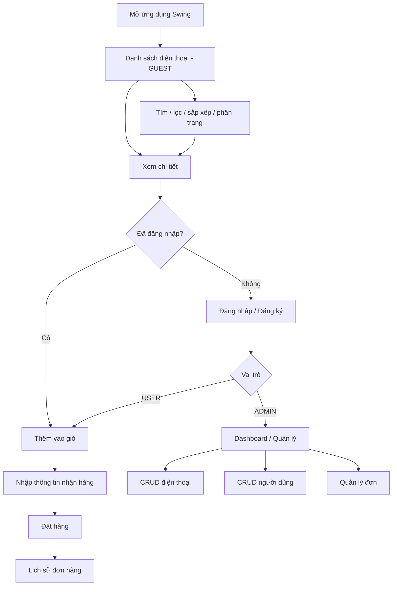
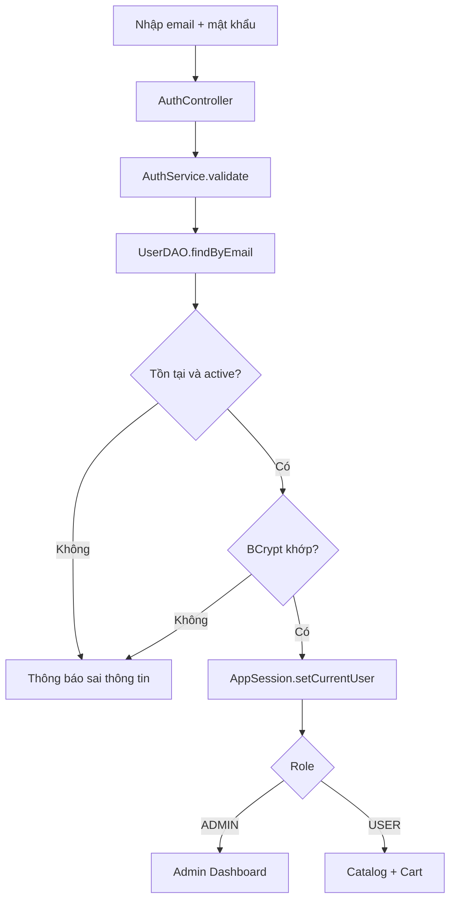
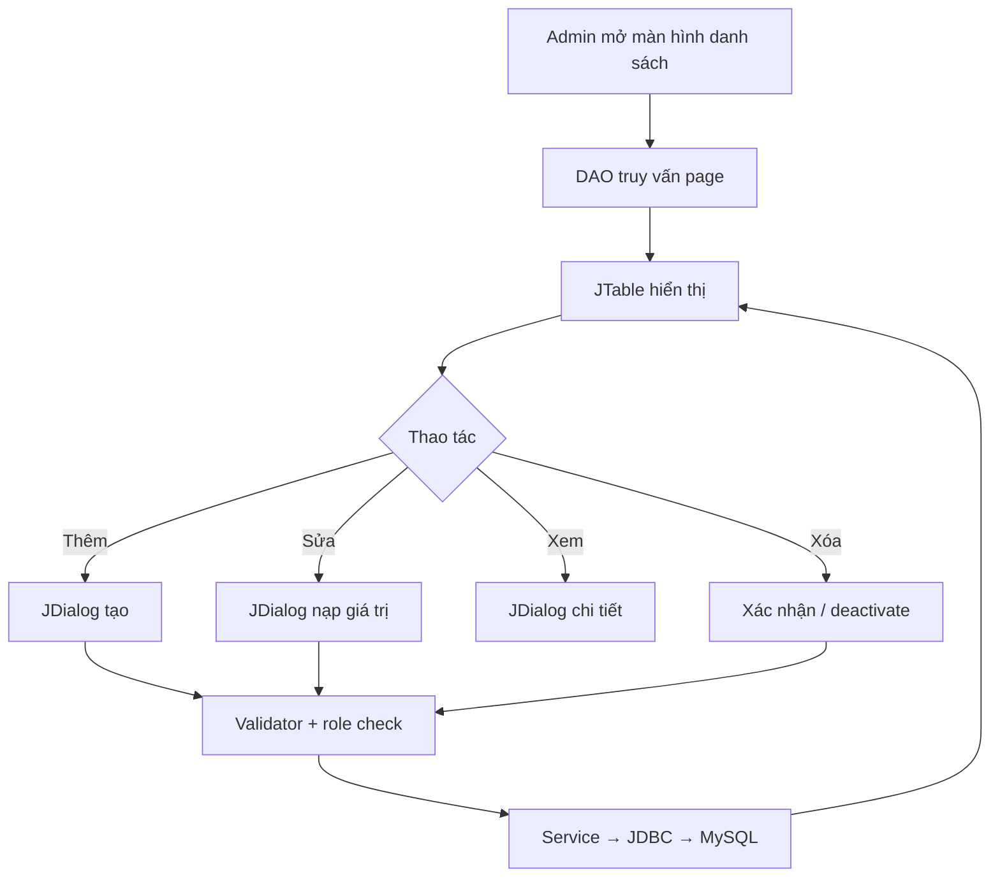
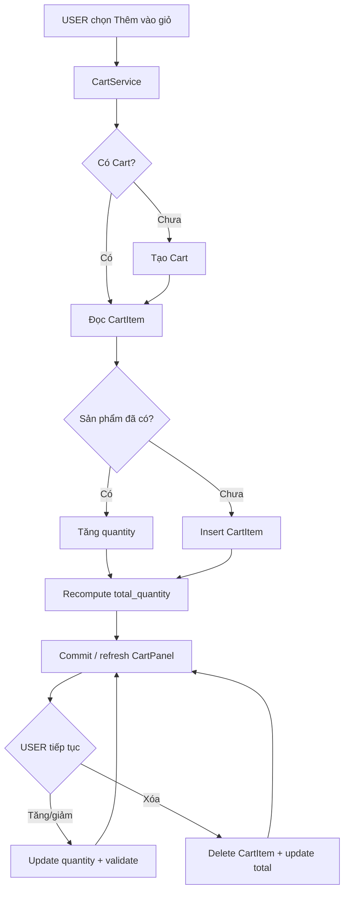
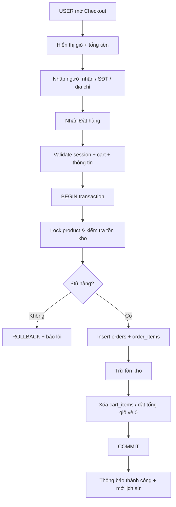
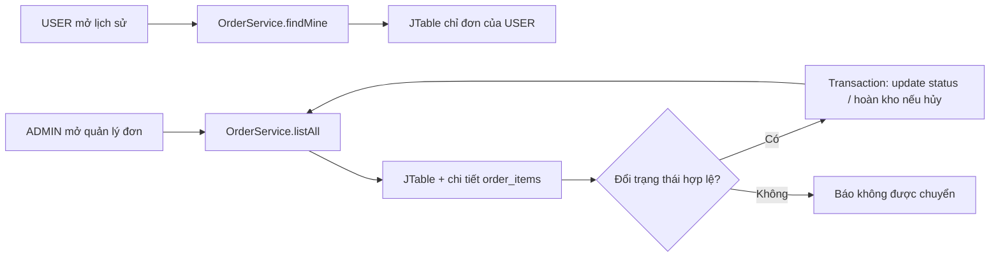

# SƠ ĐỒ LUỒNG NGHIỆP VỤ — DÙNG CHO CODE VÀ BÁO CÁO

> Những sơ đồ này mô tả **cách người dùng sử dụng phần mềm** và lớp xử lý tương ứng. Nguồn chức năng: tài liệu Spring MVC các bài #51–156; kỹ thuật Swing/JDBC là thiết kế chuyển đổi.

## 1. Luồng người dùng tổng quan


## 2. Luồng login và role


## 3. Luồng admin CRUD user và product


## 4. Luồng giỏ hàng


## 5. Luồng checkout có transaction


## 6. Luồng admin xử lý đơn và người mua xem lịch sử


## 7. Luồng filter + pagination đồng nhất
```mermaid
flowchart TD
  A[Nhập keyword, chọn hãng, giá, mục đích, sort] --> B[ProductSearchCriteria]
  B --> C[Page=1 khi đổi filter]
  C --> D[ProductService.search]
  D --> E[ProductDAO - build WHERE + args]
  E --> F[SELECT ... LIMIT OFFSET]
  E --> G[COUNT(*) cùng điều kiện]
  F --> H[PageResult]
  G --> H
  H --> I[Update JTable + page x / n]
  I --> J[Next / Prev → lại Service]
```

## 8. Bản đồ màn hình
| Nhóm | Màn hình | Ai thấy | Hành động |
|---|---|---|---|
| Chung | `HomePanel` | GUEST/USER/ADMIN | Browse, search, xem detail |
| Chung | `ProductDetailDialog` | GUEST/USER/ADMIN | Xem mô tả, ảnh, giá, tồn; USER add cart |
| Auth | `LoginPanel`, `RegisterPanel` | Chưa login | Login/register |
| Người mua | `CartPanel` | USER/ADMIN | Xem, tăng/giảm/xóa |
| Người mua | `CheckoutPanel` | USER/ADMIN | Nhập người nhận, đặt đơn |
| Người mua | `OrderHistoryPanel` | USER/ADMIN | Xem các đơn của chính mình |
| Quản trị | `AdminDashboardPanel` | ADMIN | Tổng quan |
| Quản trị | `AdminUserPanel` | ADMIN | CRUD user |
| Quản trị | `AdminProductPanel` | ADMIN | CRUD product + ảnh |
| Quản trị | `AdminOrderPanel` | ADMIN | Xem/đổi trạng thái đơn |

## 9. Cách kể luồng khi thuyết trình
1. Người dùng tác động trên **Swing View**.
2. Controller chuyển yêu cầu thành DTO.
3. Service kiểm tra đăng nhập, quyền, điều kiện nghiệp vụ.
4. DAO dùng JDBC thao tác MySQL.
5. Service trả result hoặc lỗi.
6. Swing cập nhật `JTable`/`JPanel` trên EDT.
7. Riêng checkout, nhiều thao tác DB liên quan phải nằm **cùng một transaction**.

Không nói “trình duyệt gọi API” khi dự án **không có web backend**. Sơ đồ không có HTTP route; tất cả hành động là sự kiện của UI desktop.
